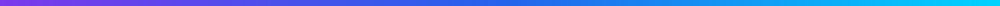

<!-- ╔══════════════════════════════════════════════════════════════╗ -->
<!-- ║        ✨ Harshit Tripathi — GitHub Profile README ✨          ║ -->
<!-- ╚══════════════════════════════════════════════════════════════╝ -->

<!-- 🌊 ANIMATED WAVING HEADER -->
<div align="center">
  
</div>

<!-- ⌨️ ANIMATED TYPING EFFECT -->
<div align="center">
  <a href="https://github.com/Harshit-888">
    
  </a>
</div>

<!-- 🏷️ LIVE BADGES ROW -->
<div align="center">
  
  <a href="https://github.com/Harshit-888?tab=followers"></a>
  
  
</div>

<br/>

<!-- 🧠 NEURAL BANNER -->
<div align="center">
  
</div>

<br/>

<!-- ══════════════════════════ ABOUT ME ══════════════════════════ -->

##  Hey there, I'm Harshit!


🚀 **AI/ML Enthusiast & Full-Stack Developer** from India 🇮🇳, on a mission to turn intelligent ideas into immersive digital products.

- 🔭 Currently building **AI-powered web apps** & a **60fps 3D WebGL portfolio** with custom GLSL shaders
- 🌱 Deep-diving into **Machine Learning, Deep Learning & Generative AI**
- 🧠 Creator of **Project Neura** — an AI-based Student Performance Predictor
- 🎓 Builder of **Campus Toolkit** — student productivity tools (Attendance · GPA · Pomodoro)
- 👯 Looking to collaborate on **AI/ML, Open Source & innovative web projects**
- 🎯 Actively seeking **Internships & Collaboration** opportunities
- 💬 Ask me about **Python, React, TypeScript, Next.js & Three.js**
- ⚡ Fun fact: I don't just build websites — I build *experiences* ✨

<br clear="both"/>

<!-- 👨‍💻 ME, AS CODE -->
```python
class HarshitTripathi:
    """Turning coffee ☕ + curiosity 🔍 into intelligent software."""

    def __init__(self):
        self.role      = "AI/ML Enthusiast & Full-Stack Developer"
        self.languages = ["Python", "TypeScript", "JavaScript"]
        self.frontend  = ["React", "Next.js", "Three.js", "Tailwind CSS"]
        self.passion   = "Building intelligent, immersive experiences"
        self.open_to   = ["Internships", "Collaboration", "Open Source"]

    def say_hi(self):
        print("Thanks for stopping by — let's build something extraordinary! 🚀")

me = HarshitTripathi()
me.say_hi()
```

<div align="center"></div>

<!-- ══════════════════════════ TECH STACK ══════════════════════════ -->

## 🛠️ My Tech Arsenal

<!-- ✏️ EDIT ME: add/remove skills at https://skillicons.dev -->
<div align="center">

### 💻 Languages


### 🎨 Frontend & 3D Web

<br/>


### 🤖 AI / ML & Data &nbsp;<sub><i>(exploring & building)</i></sub>


### ⚙️ Backend & Databases


### 🧰 Tools & Platforms


</div>

<div align="center"></div>

<!-- ══════════════════════════ FEATURED PROJECTS ══════════════════════════ -->

## 🚀 Featured Projects

<div align="center">

| 🌟 Project | 💡 What It Is | 🛠️ Built With |
|:--|:--|:--|
| 🌐 [**3D WebGL Portfolio**](https://github.com/Harshit-888/portfolio) | Interactive **60fps 3D portfolio** with custom WebGL2/GLSL shaders & real-time physics | React Three Fiber · Three.js · GSAP · Rapier 3D |
| 🧠 [**Project Neura**](https://github.com/Harshit-888/Project-Neura) | **AI-Based Student Performance Predictor** that forecasts academic outcomes with ML | TypeScript · Machine Learning |
| 🎓 [**Campus Toolkit**](https://github.com/Harshit-888/Campus-Toolkit) | 100% client-side student toolkit — **Attendance, GPA/CGPA, JSON↔CSV & Pomodoro** | Next.js 14 · TypeScript · Tailwind CSS |
| 👤 [**Student Profile**](https://github.com/Harshit-888/Student-Profile) | Clean, responsive **Student Profile UI** built with modern React patterns | React · CSS |

</div>

<!-- 📌 LIVE PINNED REPO CARDS -->
<div align="center">
  <a href="https://github.com/Harshit-888/Campus-Toolkit"></a>
  <a href="https://github.com/Harshit-888/Project-Neura"></a>
  <a href="https://github.com/Harshit-888/portfolio"></a>
  <a href="https://github.com/Harshit-888/Student-Profile"></a>
</div>

<div align="center"></div>

<!-- ══════════════════════════ GITHUB STATS ══════════════════════════ -->

## 📊 GitHub Analytics

<div align="center">
  
  
</div>

<div align="center">
  
</div>

<!-- 🏆 TROPHIES -->
<div align="center">
  <h3>🏆 GitHub Trophies</h3>
  
</div>

<!-- 📈 ACTIVITY GRAPH -->
<div align="center">
  <h3>📈 Contribution Activity</h3>
  
</div>

<!-- 🐍 SNAKE EATING MY CONTRIBUTIONS (auto-generated by .github/workflows/snake.yml) -->
<div align="center">
  <h3>🐍 Watch the Snake Devour My Contributions</h3>
  <picture>
    <source media="(prefers-color-scheme: dark)" srcset="https://raw.githubusercontent.com/Harshit-888/Harshit-888/output/snake-dark.svg"/>
    <source media="(prefers-color-scheme: light)" srcset="https://raw.githubusercontent.com/Harshit-888/Harshit-888/output/snake.svg"/>
    
  </picture>
</div>

<div align="center"></div>

<!-- ══════════════════════════ GOALS + QUOTE ══════════════════════════ -->

## 🎯 The Journey Ahead

<details>
  <summary><b>🗺️ My 2026 Roadmap — click to expand!</b></summary>
  <br/>

  - [ ] 🤖 Ship a **production-grade AI/ML project** end-to-end
  - [ ] 🌐 Launch my **3D WebGL portfolio** to the world
  - [ ] 💼 Land an **AI/Full-Stack internship**
  - [ ] 🌱 Contribute to **major open-source** projects
  - [ ] 🧠 Master **Deep Learning & Generative AI / LLMs**
  - [ ] 📝 Start sharing my learnings through **blogs & content**

</details>

<details>
  <summary><b>⚡ Random Dev Facts About Me</b></summary>
  <br/>

  - 🐍 Python was my first love — React made it a universe
  - 🎨 I obsess over the intersection of **AI + beautiful UI**
  - 🌙 Best code gets written after midnight
  - 🚀 Believer in *"Build. Break. Learn. Repeat."*

</details>

<br/>

<!-- 💭 RANDOM DEV QUOTE (refreshes daily) -->
<div align="center">
  
</div>

<div align="center"></div>

<!-- ══════════════════════════ CONNECT ══════════════════════════ -->

## 🤝 Let's Connect & Build Together!

<!-- ✏️ TODO: Replace the placeholder links below (your-username / your.email) with your real ones! -->
<div align="center">
  <a href="https://www.linkedin.com/in/your-username" target="_blank"></a>
  <a href="mailto:your.email@gmail.com"></a>
  <a href="https://x.com/your-username" target="_blank"></a>
  <a href="https://github.com/Harshit-888/portfolio" target="_blank"></a>
  <a href="https://github.com/Harshit-888" target="_blank"></a>
</div>

<br/>

<div align="center">
  <i>💡 "The best way to predict the future is to build it — preferably with AI."</i>
  <br/><br/>
  ⭐ <b>If you like my work, consider starring my repositories — it fuels the journey!</b> ⭐
</div>

<br/>

<!-- 🌊 ANIMATED WAVING FOOTER -->
<div align="center">
  
</div>

<div align="center"><a href="#top">⬆️ Back to Top</a></div>
