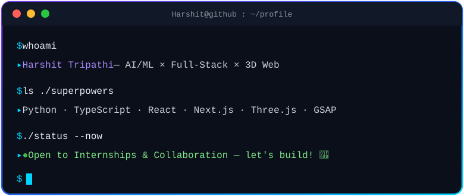
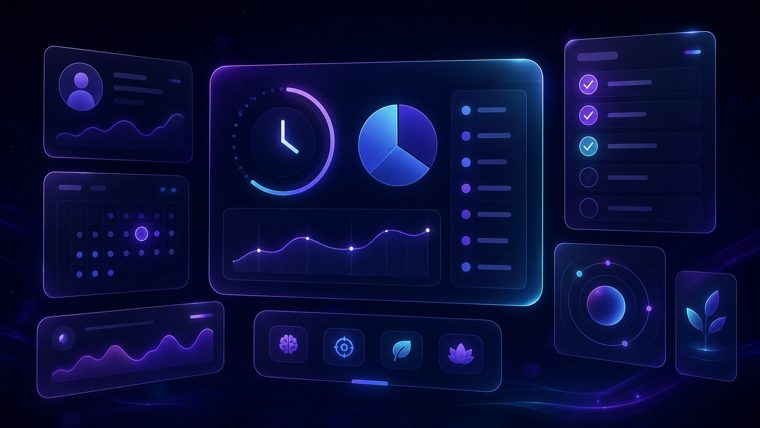
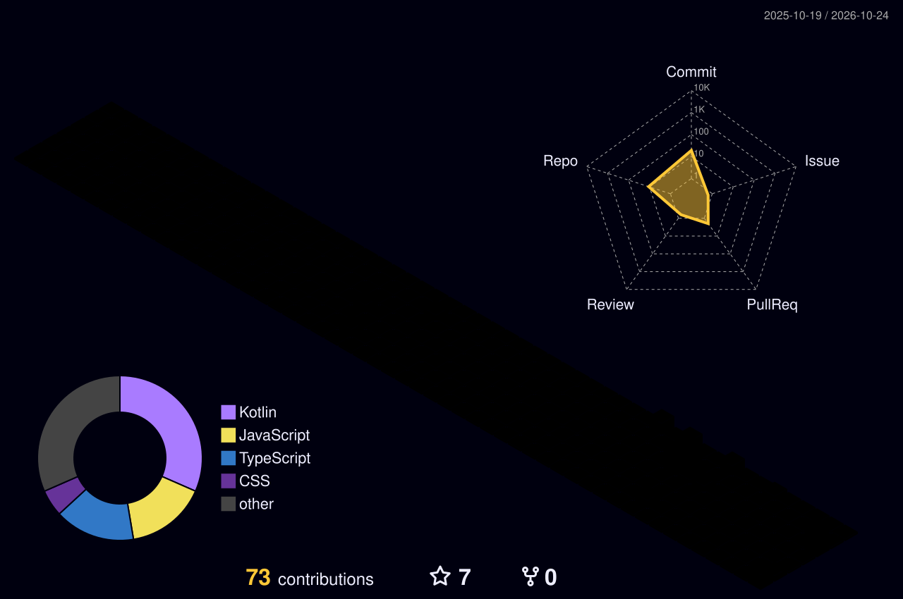
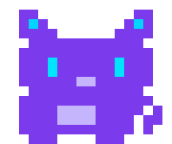

<!-- ✨ Harshit Tripathi — GitHub Profile v2 · visual-first, almost zero text ✨ -->

<!-- 🌊 HEADER -->

  
  
   
  
  
  

<!-- 🖥️ ANIMATED TERMINAL (hand-crafted SVG — ./assets/terminal.svg) -->

  

<!-- 🛠️ TECH — one icon wall, zero paragraphs -->
<h2 align="center">🛠️</h2>

  
   
  
  
  

<!-- 🚀 PROJECTS — image cards only -->
<h2 align="center">🚀</h2>
<table align="center" width="100%">
  <tr>
    <td align="center" width="50%">
      
       <b>🌐 3D WebGL Portfolio</b> 
      
    </td>
    <td align="center" width="50%">
      
       <b>🧠 Project Neura — AI Predictor</b> 
      
    </td>
  </tr>
  <tr>
    <td align="center" width="50%">
      
       <b>🎓 Campus Toolkit</b> 
      
    </td>
    <td align="center" width="50%">
      
       <b>👤 Student Profile</b> 
      
    </td>
  </tr>
</table>

<!-- 📊 ANALYTICS — summary-card dashboard -->
<h2 align="center">📊</h2>

  
  
  
  
   
  

<!-- 🏙️ 3D SKYLINE (auto-generated daily by .github/workflows/profile-3d.yml) -->
<h2 align="center">🏙️</h2>

  

<!-- 🕹️ ARCADE (auto-generated by .github/workflows/animations.yml → output branch) -->
<h2 align="center">🕹️</h2>

  <picture>
    <source media="(prefers-color-scheme: dark)" srcset="https://raw.githubusercontent.com/Harshit-888/Harshit-888/output/pacman-contribution-graph-dark.svg"/>
    <source media="(prefers-color-scheme: light)" srcset="https://raw.githubusercontent.com/Harshit-888/Harshit-888/output/pacman-contribution-graph.svg"/>
    
  </picture>

  
<b>🎮 More games — Breakout 🧱 & Snake 🐍</b>

   
  <picture>
    <source media="(prefers-color-scheme: dark)" srcset="https://raw.githubusercontent.com/Harshit-888/Harshit-888/output/breakout-contribution-graph-dark.svg"/>
    <source media="(prefers-color-scheme: light)" srcset="https://raw.githubusercontent.com/Harshit-888/Harshit-888/output/breakout-contribution-graph.svg"/>
    
  </picture>
   
  <picture>
    <source media="(prefers-color-scheme: dark)" srcset="https://raw.githubusercontent.com/Harshit-888/Harshit-888/output/snake-dark.svg"/>
    <source media="(prefers-color-scheme: light)" srcset="https://raw.githubusercontent.com/Harshit-888/Harshit-888/output/snake.svg"/>
    
  </picture>

<!-- 💭 DAILY QUOTE -->

  

 

<!-- 🤝 CONNECT -->
<!-- ✏️ TODO: replace your-username / your.email placeholders with real links -->

  
  
  
  
  

 

<!-- 🐱 PIXEL PET + FOOTER -->

  
  

<a href="#top">⬆️</a>

